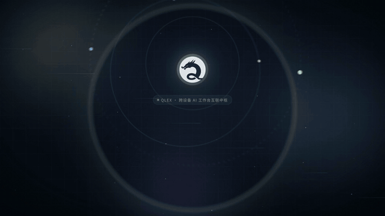
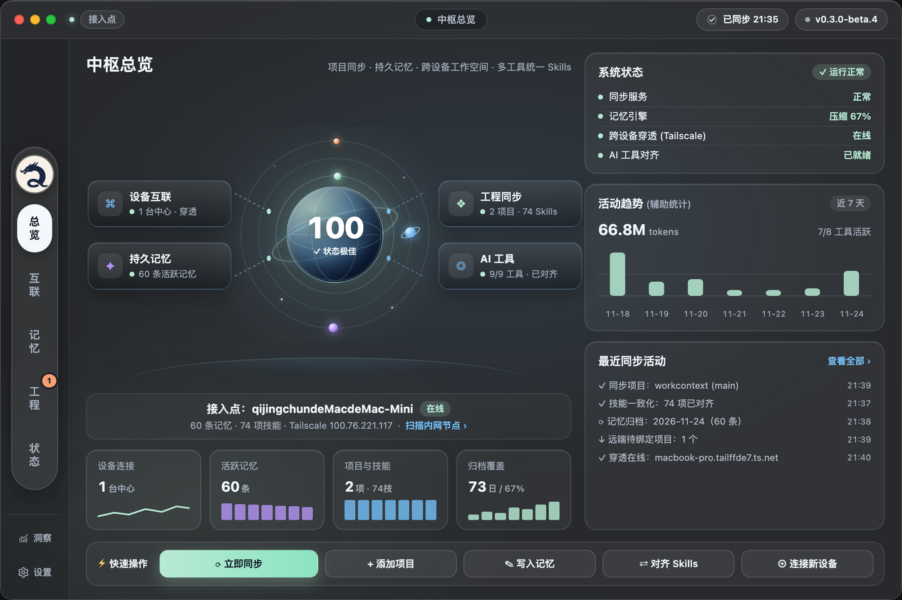
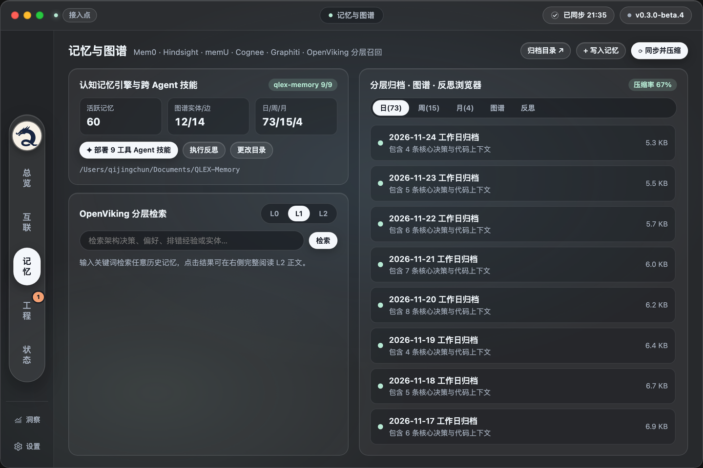
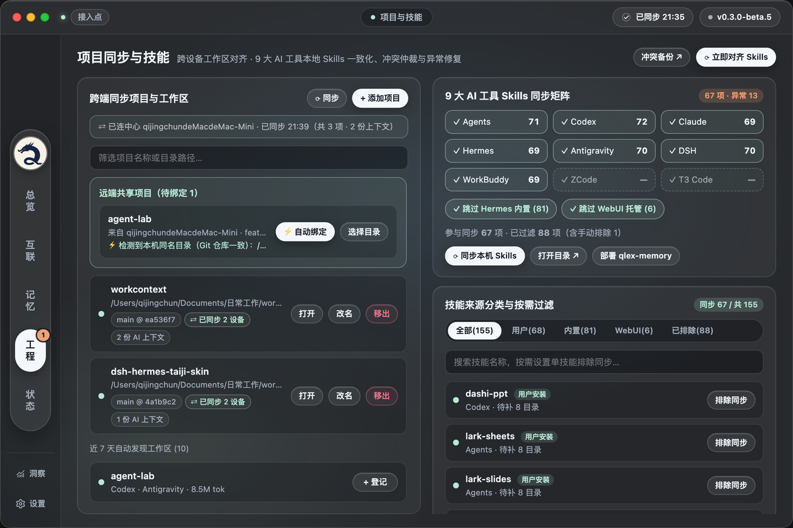
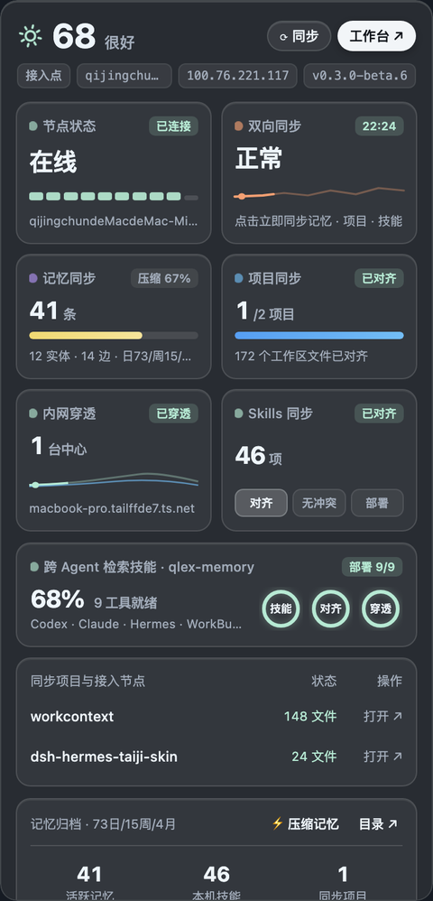
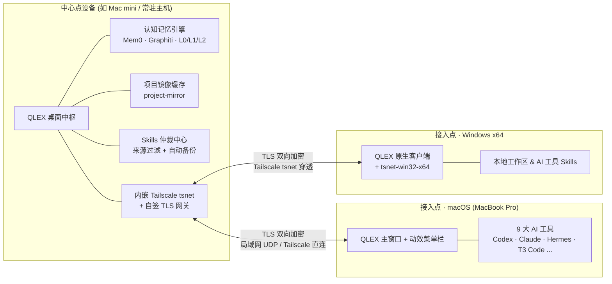

<div align="center">


# QLEX

### 多端 AI 工作台互联中枢

**换一台设备、换一个 Agent，你的记忆、项目文件与 Skills 始终在线。**

<p>
  <a href="https://github.com/haoyu-qi/qlex/releases/latest">
    
  </a>
  <a href="https://github.com/haoyu-qi/qlex/releases">
    
  </a>
  
  
</p>

<p>
  <a href="#-产品演示视频">演示视频</a> ·
  <a href="#-完整产品功能说明">完整功能</a> ·
  <a href="#-实机界面一览">界面一览</a> ·
  <a href="#-支持的-9-大-ai-工具">支持工具</a> ·
  <a href="#-系统架构">系统架构</a> ·
  <a href="#-下载与安装">下载安装</a> ·
  <a href="#-5-分钟快速上手">快速上手</a>
</p>

</div>

---

## 🎬 产品演示视频

<div align="center">

[](https://github.com/haoyu-qi/qlex/releases/download/v0.7.0-beta.6/QLEX-v0.3.0-Promo.mp4)

<p>
  <strong>
    <a href="https://github.com/haoyu-qi/qlex/releases/download/v0.7.0-beta.6/QLEX-v0.3.0-Promo.mp4">
      ▶ 点击画面或此处观看 / 下载 1080p 完整有声宣传片（MP4 · 30s · 1920×1080 · 含配乐与音效）
    </a>
  </strong>
</p>

</div>

---

## 💡 为什么需要 QLEX？

当你同时使用 **公司电脑 / 家用 Mac mini / 笔记本 / Windows 主机**，并在 **Codex、Claude Code、Hermes、Antigravity、T3 Code** 等多个 AI 工具之间切换时，工作上下文天然被割裂：

| 常见痛点 | QLEX 提供的统一解法 |
| --- | --- |
| 换台电脑或换个 AI 工具，历史偏好、架构决策与排错经验全部丢失 | **持久认知记忆引擎 + `qlex-memory` 技能**，9 大 AI 工具共享同一份跨设备长期记忆与双时态图谱 |
| 多个 AI 工具各自的 Skills 目录互不相通，还常混入大量内置技能导致同步冲突 | **9 工具 Skills 同步矩阵 + 来源智能过滤**，自动区分并跳过 Hermes 内置 / WebUI 托管技能，冲突自动备份仲裁 |
| 跨设备切换项目不仅要手动找目录，未提交的文档、草稿与任务文件也难以对齐 | **真实项目与工作区文件双向同步**，支持增量文件快照推送/落盘、Git 仓库自动匹配与空目录一键同步 |
| 异地办公访问家里主力机需要手动折腾公网 IP、FRP 或复杂客户端配置 | **中心点 / 接入点 + 内嵌 Tailscale（`tsnet`）**，一次性邀请码配对、自签 TLS 加密、免装客户端即可穿透直连 |

---

## ✨ 完整产品功能说明

### 1. 中枢总览与太阳系同步核心（Overview Hub）
- **直观空间布局**：左侧竖向拉长胶囊导航（`总览 / 互联 / 记忆 / 工程 / 状态`）+ 中央**太阳系核心状态舱**，围绕核心实时呈现实景连接、记忆、工程与 AI 工具四大模块状态。
- **实时健康评分**：综合节点在线态、记忆归档覆盖、项目同步与 Skills 一致性实时计算健康分（`0–100`），异常或冲突一键直达修复。
- **遥测与动态活动**：内置近 7 天 Token 用量与多工具活跃趋势统计、实时同步事件流，以及底部「立即同步 / 添加项目 / 写入记忆 / 对齐 Skills / 连接新设备」一键快捷操作栏。

### 2. 跨设备互联与内网穿透（Center & Endpoint）
- **中心点 / 接入点拓扑**：将一台常驻设备（如 Mac mini 或工作站）设为 **中心点（Center）**，其余 macOS / Windows 设备作为 **接入点（Endpoint）** 随时接入。
- **零信任配对安全**：通过一次性邀请码发起接入，中心点支持设备审批、吊销、实时心跳保活与自签 TLS 证书加密传输。
- **三通道自动发现与穿透**：
  - **局域网 UDP 广播发现**：同局域网自动发现中心节点，免手填 IP。
  - **内嵌 Go `tailscale.com/tsnet` Sidecar**：应用内置跨平台 `tsnet` 二进制（支持 macOS arm64 与 Windows x64），无需单独安装系统 Tailscale 客户端即可获得独立内网节点域名实现跨网直连。
  - **系统 Tailscale 协同检测**：自动识别本机已有 Tailscale 网络并复用最优链路。

### 3. 持久认知记忆引擎与双时态知识图谱（Cognitive Memory）
- **多模型记忆融合架构**：结合 **Mem0**（原子记忆抽取与冲突消解）、**Hindsight**（`Retain / Recall / Reflect` 认知分区）、**memU**（`Resources / Items / Categories` 三层文件组织）与 **Graphiti**（双时态实体与关系演进图谱）。
- **OpenViking 分层检索（`qlex://`）**：支持 `L0`（摘要索引）→ `L1`（结构要点）→ `L2`（完整正文）三级按需召回，兼顾检索精度与 Token 成本。
- **日 / 周 / 月自动压缩归档**：自动归档至本机 `~/Documents/QLEX-Memory`（支持自定义目录），平均压缩率可达 **67%**；内置全高**分层归档 · 图谱 · 反思浏览器**，随时回溯任意工作日的决策与上下文。
- **双向增量同步**：中心点与接入点自动双向同步记忆库，离线写入在重连后自动合并，不丢记录。

### 4. 跨 Agent 统一检索技能（`qlex-memory`）
- **一键部署至全工具**：在 QLEX 客户端点击一次，即可将标准化 `qlex-memory` 技能与检索脚本同步部署至本机全部 9 大 AI 工具技能目录。
- **跨工具无缝接续**：在 Claude Code 里做出的架构决策，切到 Codex、Hermes 或 Antigravity 时可直接检索调用，彻底打破不同 AI 助手之间的上下文孤岛。

### 5. 真实项目与工作区文件双向同步（Workspace & File Sync）
- **真实文件内容双向同步**：不仅同步项目清单、Git 分支与 AI 上下文元数据，更支持**真实工作区文件（源码、文档、任务文件等）的双向增量同步**（gzip 压缩快照、Center 中继镜像缓存 `project-mirror`）。
- **空目录一键落盘 & 自动绑定**：新设备收到远端共享项目后，支持「⚡ 自动绑定」识别本机同名 Git 仓库，或选择空目录直接将远端工作区文件完整拉取落盘。
- **安全边界与自动过滤**：文件同步默认自动过滤 `.git/`、`node_modules/`、`dist/`、`.env`、私钥与大体积构建产物，并在覆盖冲突文件前自动留存本地安全备份。
- **跨端删除同步（Tombstone）**：支持项目移出状态跨设备一致传播，避免已移除项目被旧节点反复“复活”。

### 6. 9 大 AI 工具 Skills 智能一致化与来源过滤（Skills Matrix）
- **多工具统一对齐**：自动扫描本机 9 大 AI 工具的 Skills 目录，实时呈现每个工具的技能数、缺失项与版本差异。
- **原生来源识别与智能过滤**：精准识别 Hermes 官方内置技能（`.bundled_manifest` 与官方分类目录，共 81 项）及 WebUI 托管技能（`.webui-managed-skills.json` / `.hub/lock.json`，共 6 项），**默认自动跳过系统内置与托管技能**，仅同步你真正安装和定制的个人 Skills。
- **单技能精细控制与冲突仲裁**：支持在界面按来源标签（`全部 / 用户 / 内置 / WebUI / 已排除`）搜索并设置单技能排除；遇到同名冲突时提供按最新覆盖、保留差异与自动备份至 `~/.qlex-skill-backups`。
- **跨平台一致性校验**：采用独立于 POSIX 权限位的内容哈希算法，确保 macOS 与 Windows NTFS 之间同步 Skills 零误报冲突。

### 7. 灵动菜单栏动效面板与桌面体验（Menubar & Side Dock）
- **16 帧视网膜动效托盘图标**：macOS 菜单栏配备 16 帧 `@2x` 卫星环绕动态图标，根据连接、同步中、告警状态自动切换动效节奏。
- **实时律动毛玻璃悬浮面板**：点击菜单栏图标即时展开模块化状态卡（健康评分、节点状态、双向同步波形、记忆归档、项目文件数、内网穿透、Skills 状态、跨 Agent 覆盖环与快捷操作），数据实时律动，无需切回主窗口即可一键触发同步。
- **侧边吸附模式**：支持屏幕边缘吸附悬浮，随时呼出不打断编码节奏。

### 8. 双通道自动更新与安全校验（Updater）
- 内置 `Beta` / `Stable` 双通道自动更新检测，直连 GitHub Releases 资源地址，支持下载进度展示与强制 **SHA-256** 完整性校验，适配 macOS（`.pkg` / `.zip`）与 Windows（`Setup.exe` / `Portable.zip`）。

---

## 📸 实机界面一览

<table>
  <tr>
    <td align="center" width="50%">
      
      <br />
      <strong>中枢总览 · 太阳系同步核心与全局遥测</strong>
    </td>
    <td align="center" width="50%">
      
      <br />
      <strong>记忆与图谱 · 日/周/月压缩归档与 L0/L1/L2 检索</strong>
    </td>
  </tr>
  <tr>
    <td align="center" width="50%">
      
      <br />
      <strong>项目文件双向同步 & 9 大 AI 工具 Skills 智能过滤</strong>
    </td>
    <td align="center" width="50%">
      
      <br />
      <strong>macOS 动效菜单栏实时律动状态面板</strong>
    </td>
  </tr>
</table>

---

## 🤖 支持的 9 大 AI 工具

QLEX 已原生适配以下 9 类本地 AI 编程与智能体工具目录（支持 macOS & Windows 跨平台路径自动探测）：

| AI 工具 | Skills 一致化同步 | `qlex-memory` 一键部署 | 来源智能过滤 / 活跃采集 |
| --- | :---: | :---: | :---: |
| **Codex** (`~/.codex/skills`) | ✅ | ✅ | ✅ |
| **Claude Code** (`~/.claude/skills`) | ✅ | ✅ | ✅ |
| **Hermes** (`~/.hermes/skills`) | ✅ | ✅ | ✅ 自动区分内置 (81) 与 WebUI 托管 (6) |
| **Antigravity** (`~/.gemini/antigravity/skills`) | ✅ | ✅ | ✅ |
| **DeepSeek Harness / DSH** (`~/.dsh/skills`) | ✅ | ✅ | ✅ |
| **WorkBuddy** (`~/.workbuddy/skills`) | ✅ | ✅ | ✅ |
| **ZCode** (`~/.zcode/skills`) | ✅ | ✅ | ✅ |
| **T3 Code** (`~/.t3/skills`) | ✅ | ✅ | ✅ |
| **Agents 通用目录** (`~/.agents/skills`) | ✅ | ✅ | ✅ |

---

## 🏗️ 系统架构



---

## 📦 下载与安装

前往 **[GitHub Releases](https://github.com/haoyu-qi/qlex/releases/tag/v0.7.0-beta.6)** 下载最新预编译安装包（均附带 `SHA256SUMS.txt` 校验文件）：

| 平台 | 安装形态 | 说明与下载 |
| --- | --- | --- |
| **macOS Apple Silicon** | `.pkg` 安装包（推荐） | [QLEX-0.3.0-beta.6-macOS-arm64.pkg](https://github.com/haoyu-qi/qlex/releases/download/v0.7.0-beta.6/QLEX-0.3.0-beta.6-macOS-arm64.pkg) · 自动安装至 `/Applications/QLEX.app` |
| **macOS Apple Silicon** | `.zip` 便携压缩包 | [QLEX-0.3.0-beta.6-macOS-arm64.zip](https://github.com/haoyu-qi/qlex/releases/download/v0.7.0-beta.6/QLEX-0.3.0-beta.6-macOS-arm64.zip) · 解压即用 |
| **Windows x64** | `Setup.exe` 安装向导（推荐） | [QLEX-0.3.0-beta.6-Windows-x64-Setup.exe](https://github.com/haoyu-qi/qlex/releases/download/v0.7.0-beta.6/QLEX-0.3.0-beta.6-Windows-x64-Setup.exe) · 支持自选路径、桌面与开始菜单快捷方式 |
| **Windows x64** | `Portable.zip` 绿色便携版 | [QLEX-0.3.0-beta.6-Windows-x64-Portable.zip](https://github.com/haoyu-qi/qlex/releases/download/v0.7.0-beta.6/QLEX-0.3.0-beta.6-Windows-x64-Portable.zip) · 免安装解压运行 |

> **提示**：更新通道支持在应用内「设置 → 检查更新」自由切换 **Beta 通道**（尝鲜最新功能）与 **Stable 通道**（稳定版）。

---

## 🚀 5 分钟快速上手

1. **指定中心点**：在主力常驻设备（如 Mac mini）打开 QLEX，在「设备互联」页选择 **设为中心点**，自动启动本地加密同步网关。
2. **开启跨网穿透（可选）**：同局域网可直接使用自动发现；如需跨网络互联，在「设备互联」一键开启 **内置 Tailscale（`tsnet`）** 登录授权即可获得专属穿透地址。
3. **接入其他设备**：在中心点生成 **一次性邀请码**，在 MacBook 或 Windows 电脑的 QLEX 客户端输入邀请码（或点击自动发现到的节点）完成加密配对。
4. **开启同步与部署技能**：
   - 在「记忆与图谱」点击 **部署 9 工具 Agent 技能**，让所有本机 AI 工具自动获得跨端长期记忆能力；
   - 在「项目同步与技能」添加要跨设备协作的工作区目录，并一键对齐 9 大工具的自定义 Skills（自动过滤内置技能）。

---

## 🛠️ 从源码运行与构建

### 桌面客户端（Electron · macOS & Windows）

```bash
cd qlex-client
npm install

# 启动桌面端
npm start

# 运行核心测试套件
node scripts/test-memory-framework.mjs
node scripts/test-v020-features.mjs

# 打包 macOS Apple Silicon (.app / .zip / .pkg)
npm run build:mac

# 打包 Windows x64 (NSIS Setup.exe & Portable.zip，建议在 Windows 环境或 GitHub Actions 构建)
npm run build:win
```

> 仓库已配置自动化 Windows 构建流水线：[`.github/workflows/build-windows.yml`](.github/workflows/build-windows.yml)，支持自动编译 Go `qlex-tsnet-win32-x64.exe` 并封装双格式安装包。

### 服务端与 CLI 伴随套件（Python 3.9+）

仓库同时提供无界面服务端与 CLI 套件（新增 `qlex` 命令入口，并向后兼容 `workcontext` 模块导入），适用于服务器常驻部署、Relay 采集、MCP 记忆服务与受控技能分发：

```bash
python -m pip install .
qlex selfcheck
qlex --help
```

---

## 📚 相关文档

- [QLEX 桌面端与认知记忆架构设计](public-docs/QLEX-ARCHITECTURE.md)
- [QLEX 版本规划与迭代记录](public-docs/QLEX-NEXT-VERSION-PLAN.md)
- [长期记忆与跨端 Relay 部署说明](public-docs/LONG-TERM-MEMORY.md)
- [服务端运维、浏览器控制台与技能分发](public-docs/OPERATIONS.md)
- [整体服务架构与边界说明](public-docs/ARCHITECTURE.md)
