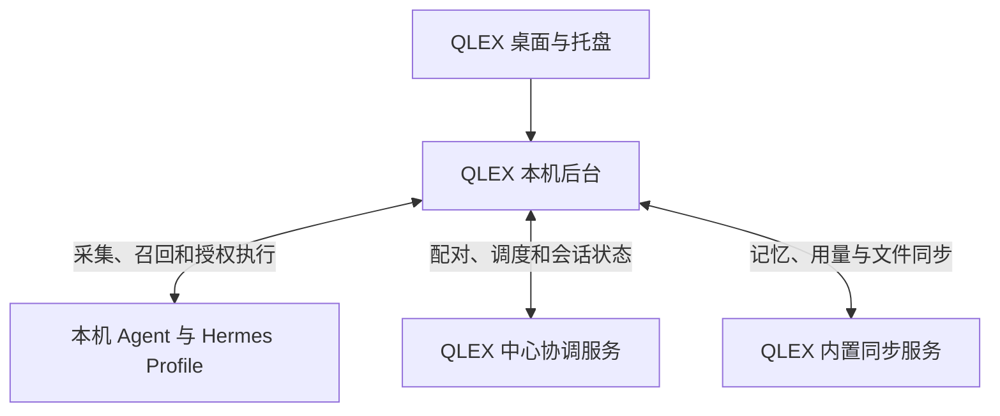

# QLEX 产品与技术架构

**状态：设计基线，待实现**

QLEX 是面向 Windows 和 macOS 的本地优先 AI 项目工作台。它把同一项目在不同电脑、Agent 和 Hermes Profile 上的记忆、会话、用量及产物汇到一个入口。两端安装同一个客户端。任意一台受支持的电脑可设为中心，也可使用单机模式。

## 1. 产品形态

| 入口 | 用户可以完成的操作 |
| --- | --- |
| 总览 | 继续最近的项目和任务，查看设备在线状态、同步异常、待确认记忆和今日 Token |
| 项目 | 查看项目时间线、项目记忆、会话、Token 和交付文件，绑定各设备上的工作区 |
| 会话 | 按项目、设备和 Agent 实例查看历史；在获授权的远端工作区新建、续接或停止会话 |
| 用量 | 按项目、设备、实例、模型和时间查看用量；从汇总下钻到可归属的会话 |
| 设备 | 设为中心、加入中心、配置共享范围、发现本机实例、诊断同步及撤销设备 |
| 托盘 / 菜单栏 | 查看今日用量、同步状态和待处理异常，打开工作台 |

**首次使用。** 用户选择「仅在本机使用」「设为中心」或「加入中心」。本机扫描展示发现的 Agent 和 Profile，用户选定采集目录并绑定项目。加入端通过一次性邀请确认中心身份，选择本机目录和可共享内容后开始同步。配对时自动准备授权范围内的内置同步。远程执行按工作区单独开启。

**日常闭环。** 在项目页查阅上次决定，在指定设备上续接原生会话，完成后回到同一个项目查看结果及用量。经人工确认的经验可以沉淀成记忆，下次由本机 Agent 召回。用户可以打开来源，也能看到来源仅在另一台设备可读的状态。

## 2. 系统架构

- **桌面与后台。** 采用 Electron + TypeScript。桌面渲染进程通过白名单 IPC 访问本机后台，凭证由后台管理。桌面端内置同步客户端及记忆版本模块。后台统一管理同步、Python 核心和中心端 Go 进程，关闭主窗口后服务可继续运行。
- **节点职责。** 各节点就地发现和采集 Agent，保存本机索引与同步待发记录。节点可同时承担发起端、执行端和中心角色。中心协调设备、共享范围及远程执行，各节点可保留离线可读的本机数据。
- **同步服务。** QLEX 安装包同时提供同步客户端与 Go 同步服务。设备设为中心时，QLEX 自动初始化、启动和监督该服务，保存同步文件与版本。加入端通过一次配对获取授权范围内的同步配置。内置同步沿用 HTTP 和 WebSocket 传输，在局域网或 Tailscale 等私有网络上校验 HTTPS 服务身份。
- **安装交付。** QLEX 随安装包提供运行所需的后台程序。Windows x64 和 macOS Apple Silicon 先完成原生安装及中心验收，macOS Intel 纳入单独构建矩阵。内置同步服务的 macOS 构建、应用签名和真实设备联调纳入双端发布验收。QLEX 正式安装包的签名和 macOS 公证是发布验收项。

## 3. 现有项目与新模块的分工

| 能力 | 复用或改造 |
| --- | --- |
| 本机采集与归档 | 复用 WorkContext 的 `source_logs`、`memory_relay` 和来源引用，增加按设备与 Agent 实例识别及可见范围 |
| 项目记忆与召回 | 沿用记忆版本文件与冲突处理机制，复用 WorkContext 的提取、索引、MCP 和 Hermes 插件。每个项目只维护一套共享记忆版本 |
| 文件同步与备份 | 由 QLEX 内置同步提供双向文件传输、分库授权、校验、历史版本与备份 |
| 固定能力任务 | 保留 WorkContext 的 `execution`、`execution_worker` 和 MCP 入口，继续按 OS、版本、节点和能力调度 |
| 原生 Agent 会话 | 采用 AI Link 的会话模型，新增 QLEX 会话适配层。首批验证 Codex、Claude Code 的新建、续接、读取和停止，分叉按后端能力开放 |
| Token 统计 | 参考 TokenMonitor 和 ai-token-monitor，新增独立本地解析器和统一口径。首批覆盖 Hermes 多 Profile、Codex、Claude Code |
| 技能分发 | 保留 WorkContext 的 `skill_sync` 清单、校验、平台规则与回滚。用户授权后才将选中版本分发至指定实例 |

### 数据模型与权威来源

| 对象 | 标识、存储与边界 |
| --- | --- |
| 项目 / 工作区 | 中心分配稳定项目 ID。每台设备独立登记本地路径、工作区别名和版本。仓库线索可用于建议匹配，由用户确认后关联 |
| 设备 / Agent 实例 | 设备身份独立于显示名。实例归属设备，并关联 Agent 类型、Profile、运行环境和能力。Windows 原生与 WSL 分别登记 |
| 记忆条目 / 版本 | 按项目和可见范围保存。版本含父版本、来源引用、审核状态与删除标记。SQLite 索引可以由授权版本重建 |
| 会话 / 轮次 | QLEX 会话 ID 关联执行设备、Agent 实例、原生 ID、工作区及轮次。协调状态由中心持久化，原生会话留在执行节点 |
| 用量 / 产物 | 用量归属源设备与实例，按稳定事件 ID 写入。产物通过文件库同步，记录校验值和来源任务。各端缓存可重建 |

## 4. 四条关键链路

### 4.1 配对与授权

中心签发短时、一次性邀请。加入端验证中心身份并生成设备身份，中心登记设备。中心根据项目权限自动准备文件库并签发设备专用的同步授权。授权和连接配置由 QLEX 管理，设备加入后即可在界面中选择同步范围。QLEX 中撤销设备时，同步撤销该设备的远程会话授权和文件库令牌，并展示执行到哪一步。

### 4.2 记忆发布与跨 Agent 召回

本机读取选中的原始记录与规则，生成候选摘要。用户确认后发布为项目记忆版本，QLEX 内置同步传送版本文件。接收端校验范围与文件，通过版本关系生成可召回索引。并发编辑保留分支，合并前暂停该条记忆的自动召回。删除以可同步的标记表示，恢复创建新版本。规则保留原文，经验摘要保留来源。若配置模型整理，界面说明哪些内容会发送给所选模型，并将模型处理费用计入相应来源。

Codex、Claude Code 等可沿用既有的项目记忆读取入口。Hermes 首版由 WorkContext 插件按 Profile 与项目进行召回和采集。个人通用记忆、项目共享记忆和实例私有记忆分别授权。跨设备续接时只带入目标项目可见的记录。

### 4.3 用量采集与同步

节点从本地日志或数据库读取实际可用字段，经适配器归一为设备、实例、会话、模型、时间及输入、输出、缓存类别。优先按原生请求或事件标识去重。来源只提供累计用量时，按快照口径计算增量；字段缺失显示「未知」，无法归属项目的记录单列。估算费用保留价目表版本和币种，订阅额度独立展示。

节点将只包含结构化数据的批次原子写入同步目录。中心以事件 ID 与批次回执幂等导入，同一来源修正用量时更新对应记录。用量默认按授权范围同步，不随批次发送 Prompt。重传、重复扫描、Profile 重叠与日志轮换使用固定样本对账。

### 4.4 会话续接与结果回传

发起端提交项目、授权工作区别名、目标实例和幂等键。中心校验权限与节点能力，执行端再次校验本地映射、工作区和运行权限。同一原生会话的写入串行处理。会话页展示排队、运行、待确认及终态。断网时保留已启动任务的原节点，无法确定是否执行时暂停重派。取消需要执行端确认，已产生的修改保留供用户核对。

已结束的结果、摘要及产物经 QLEX 内置同步按授权回到项目。若需换设备，用项目记忆和可见摘要在新节点开启会话，并链接原会话。Hermes 首版可通过 MCP 发起任务；远端 Hermes 运行端需通过真实会话能力验证后启用。

## 5. 同步范围、故障恢复与迁移

- **分库授权。** 一个项目的记忆、用量和资料可按共享范围使用独立库。跨设备共享的是选中的版本文件、结构化批次和授权产物。原生数据库、登录凭证和 Agent 私有配置保存在来源设备。
- **同步状态。** 客户端分别显示「待同步」「已上传」「已导入」和失败原因。文件上传完成不等于内容已可召回，导入并更新索引后才显示可用。中心离线时节点可以本地采集与检索，重连后补传。
- **文件保护。** 普通文件删除传播默认关闭。同步前检查任务目录重叠、大小写和跨系统路径冲突。旧路径标识冲突、大目录扫描成本、历史空间占用都纳入验收。文件恢复与项目记忆的版本恢复按各自来源执行。
- **中心切换。** 同一组设备保持一个调度中心。迁移前暂停旧中心写入与调度，检查在途会话状态，备份 QLEX 数据，以及内置同步的配置、索引和文件存储。恢复后核对项目、权限、版本及用量，再激活新中心并重新验证设备身份。新中心恢复内置同步服务后，设备续传本机待同步的记录。源设备上的原生会话可在该设备重新连入后继续访问。
- **旧版迁移。** 从 WorkContext 创建只读预检清单，备份原数据，将项目、来源、记忆版本和任务历史导入 QLEX，核对数量与引用后切换。已有文件库与同步任务通过迁移导入，使用同一逻辑项目 ID 映射各端目录。旧 CLI、MCP 与 Hermes 插件入口保留兼容期。新安装包、托盘和新增 CLI 使用 QLEX 名称，仓库改名在发布链接核验后执行。

## 6. 实施顺序与发布门槛

| 阶段 | 实施内容 | 验收 |
| --- | --- | --- |
| 1 · 双端和同步底座 | QLEX 桌面壳、双端内置同步服务打包、一次配对、项目映射、受控目录同步 | 在全新安装的设备上直接设为中心并配对，Windows 和 Mac 对同一文件完成往返同步。断网后补传，冲突可恢复，关闭窗口后同步可继续 |
| 2 · 项目记忆 | 内置记忆版本库、WorkContext 导入和来源索引、Hermes 多 Profile | 两台实体设备上从新会话召回同一项目规则。私有 Profile 不跨项目召回。并发编辑可恢复，旧数据导入前后可核对 |
| 3 · Token 用量 | 三类 Agent 的本地采集、结构化同步、项目用量页和托盘 | 用量与已知样本一致。重复扫描、重传和重建索引后总量一致。缺失字段可见 |
| 4 · 跨设备会话 | Codex 和 Claude Code 适配、进度与取消、结果和用量关联 | 单一原生会话完成两轮。重复发起不多跑，节点失联时显示待确认，撤销后新请求被拒绝 |
| 5 · 中心托管与正式发布 | 双端后台运行验证、跨系统备份迁移、签名安装包、QLEX 品牌切换 | Windows 和 macOS 各做一次中心，互相迁移后核对记忆、产物、用量与权限。旧版入口按兼容约定通过检查 |

**首版端到端验收。** Mac mini 作中心，MacBook 与 Windows 加入同一项目。MacBook 发布一条项目决定，Windows 上绑定该项目的 Hermes Profile 在新会话中召回并核对出处。随后从 MacBook 启动并续接 Windows 上的 Codex 会话，在 QLEX 按项目查看结果与用量。最后将中心迁至 Windows，验证已有记录及授权范围。

## 参考实现

- [WorkContext 当前架构](ARCHITECTURE.md)
- [AI Link](https://github.com/garycaogan/gary-ai-link)
- [TokenMonitor](https://github.com/Michael-OvO/TokenMonitor) · [ai-token-monitor 的 Hermes 用量参考](https://github.com/soulduse/ai-token-monitor)
