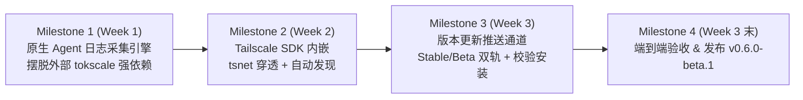
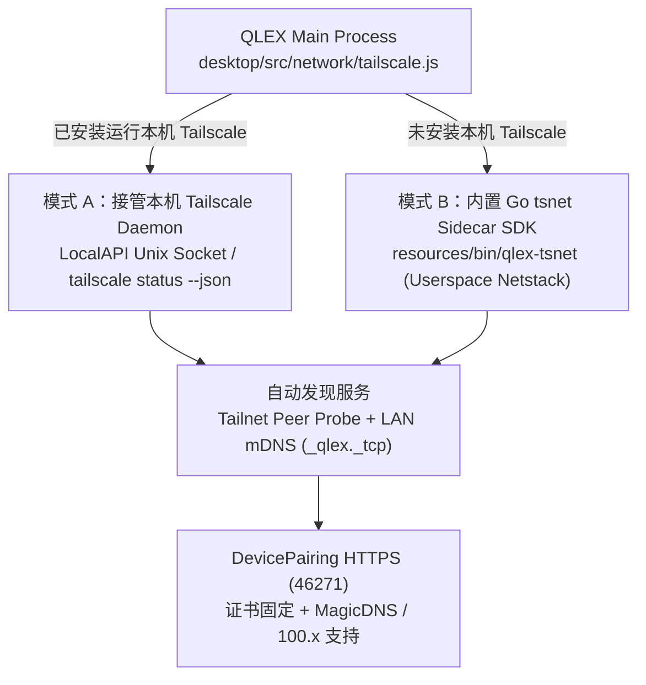

# QLEX 下一版本迭代计划（v0.6.0 / QLEX 0.2.0）

**制定日期**：2026-11-23  
**基线版本**：`v0.5.0-beta.1`（`QLEX 0.1.9-memory.2`）  
**核心目标**：解决当前客户端三大核心痛点——**本地 Agent 日志采集不完整/依赖外部工具**、**跨网设备配对缺少原生内网穿透与自动发现**、**缺少客户端版本更新推送与一键下载通道**。

---

## 总体里程碑



---

## 模块一：修复本地 Agent 工具日志采集问题

### 1.1 实测暴露的 4 个根因
1. **外部二进制强依赖**：当前 [usage.js](../qlex-client/desktop/src/usage.js) 依赖 `/Applications/Token Monitor.app/.../tokscale`；一旦目标机器未安装 Token Monitor，用量采集直接进入 `missing-engine` 降级状态。
2. **Antigravity (T3 Code ACP) 漏采**：`tokscale` 仅扫描 `~/.gemini/antigravity/`，漏掉了 T3 Code ACP 运行时写入的 `~/.t3/userdata/providers/antigravity/*/antigravity-acp/brain/*/.system_generated/logs/transcript.jsonl`，导致当日 Antigravity 用量与会话显示为 `0`。
3. **Claude Code 统计归零与时区边界偏差**：本机存在 `~/.claude/projects/` 与 `~/.claude/history.jsonl`，但采集返回 `0`（子目录嵌套 JSONL、subagent 日志路径与 UTC/本地日期边界处理不一致）。
4. **记忆引擎与用量采集割裂**：[memory-core.js](../qlex-client/desktop/src/memory-core.js) 目前仅解析 `~/.claude/history.jsonl` 和 `~/.codex/history.jsonl`（其中 Codex 新版主要写入 `~/.codex/sessions/YYYY/MM/DD/rollout-*.jsonl` 与 `logs_2.sqlite`，`history.jsonl` 已长期停更），导致 Hermes、DSH、Antigravity 与近期 Codex 会话未能同步沉淀到每日/周/月记忆与知识图谱。

### 1.2 重构方案：原生多源增量采集层（`qlex-client/desktop/src/collectors/`）

| 适配器模块 | 覆盖路径与数据源 | 采集内容 |
| --- | --- | --- |
| `collectors/codex.js` | `~/.codex/sessions/**/rollout-*.jsonl`、`~/.codex/history.jsonl`、`~/.codex/state_5.sqlite`（只读） | Token（input/output/cache）、会话、工作区、订阅额度 `rate_limits`、摘要主题 |
| `collectors/claude.js` | `~/.claude/projects/**/*.jsonl`（含 subagent）、`~/.claude/history.jsonl` | 按 `message.usage` 精确去重累加 Token、本地时区归日、工作区路径还原 |
| `collectors/antigravity.js` | `~/.gemini/antigravity/brain/**`、`~/.t3/userdata/providers/antigravity/**/antigravity-acp/brain/**/transcript.jsonl` | 会话活跃度、工具调用与 Token 估算/原始统计、对话主题沉淀 |
| `collectors/hermes.js` | `~/.hermes/state.db` / `~/.hermes/sessions/**`（兼容多 Profile） | 会话记录、模型与 Token、项目归属 |
| `collectors/dsh.js` | `$DSH_HOME`、`~/Library/Application Support/@deepseek-ai/dsh-desktop/harness/sessions`、`~/.dsh/sessions` | 会话 Token、工作区与主题摘要 |

### 1.3 关键技术点与验收标准
- **增量游标缓存（`collector-cursor.json`）**：按 `(filePath, inode, mtimeMs, size, byteOffset)` 做断点续读，日常刷新耗时 `< 150ms`，且不重复解析历史日志。
- **统一事件总线**：一次扫描同时向 `usage.js`（用量/额度/趋势）和 `memory-core.js`（每日/周/月压缩归档 + 知识图谱）供数；可选保留 `tokscale` 作为核对模式。
- **采集诊断面板（UI）**：在「设置 → 采集诊断」展示 5 大工具各自检测到的路径、最近扫描时间、命中文件数与错误原因，支持用户手动补充自定义目录。
- **验收标准**：在**未安装 Token Monitor** 的干净 macOS/Windows 环境上，5 大工具（Codex / Claude Code / Antigravity / Hermes / DSH）当日与近 7 天会话、Token、工作区及每日记忆均能准确采集且无时区漂移。

---

## 模块二：嵌入 Tailscale 工具 SDK，实现自动发现与内网穿透

### 2.1 现有局限
- 当前 [pairing.js](../qlex-client/desktop/src/pairing.js) 的邀请码仅接受裸 IPv4（`isIPv4(invite.host)`），不支持 MagicDNS（`*.ts.net`），也无法区分局域网 `192.168.x` 与 Tailscale `100.64.0.0/10` 虚拟网卡。
- 跨内网联机完全依赖用户手动安装配置 Tailscale 并手抄 IP，缺少“打开即发现同账号/同 Tailnet 下的 QLEX 设备”的体验。

### 2.2 双模式内嵌架构（零门槛 + 零冲突）



1. **模式 A — 系统 Tailscale 自动感知（优先，免重复登录）**：
   - 通过 Tailscale LocalAPI（Unix Socket / Named Pipe，降级到 `tailscale status --json`）读取 `Self.TailscaleIPs`、`Self.DNSName`、`BackendState` 及在线 `Peer[]`。
   - 零额外开销，直接复用本机已登录的 Tailnet。
2. **模式 B — 内嵌官方 Go `tsnet` SDK Sidecar（`qlex-tsnet`）**：
   - 基于官方 `tailscale.com/tsnet` 编译单文件轻量 Sidecar（`darwin-arm64`、`darwin-x64`、`win32-x64`），随 QLEX 安装包分发。
   - **纯用户态协议栈（无需 root / 无需安装系统 VPN 驱动）**：QLEX 启动时直接在应用内拉起专属节点（如 `qlex-<hostname>.tailxxxx.ts.net`），在 QLEX UI 内弹出登录 AuthURL 或填入 AuthKey 即可完成入网，并直接将本地中心 HTTPS 服务（`46271`）穿透至 Tailnet（自动 P2P WireGuard 打洞，失败自动走 DERP 中继）。
3. **自动发现与一键配对**：
   - 扫描 Tailnet 在线 Peer（优先过滤带 `qlex` 标识或探测 `/qlex/v1/discover` 轻量握手端点），并叠加局域网 mDNS（`_qlex._tcp`）兜底。
   - 在 QLEX「同步与技能」页展示**「发现的附近/内网设备」**列表：显示设备名、连接通道（`局域网直连` / `Tailscale P2P` / `Tailscale DERP 中继`）、延迟毫秒数，点击即可发起安全配对（沿用证书指纹固定 + 6 位核对码人工确认，不降低安全性）。
4. **升级 `pairing.js` 协议（`QLEX2.` 兼容 `QLEX1.`）**：
   - `invite` 支持多候选地址数组 `endpoints: [{ host, port, transport: "tailscale"|"lan" }]` 与 MagicDNS 域名；断网或切网（公司 Wi-Fi ↔ 手机热点）时自动在 LAN 与 Tailscale 间无感切换。

### 2.3 验收标准
- 已装 Tailscale 的机器零配置自动识别 `100.x` 与 MagicDNS，3 秒内发现同 Tailnet 下的另一台 QLEX 设备。
- 未装 Tailscale 的机器通过内置 `qlex-tsnet` 一键扫码/登录完成跨 NAT 穿透，完成 Skills 与记忆同步。

---

## 模块三：增加版本下载与更新推送通道

### 3.1 架构设计（Stable / Beta 双轨 + 强校验）
1. **更新清单协议（发布在 GitHub Releases 资产中）**：
   - 每次发布自动附带 `update-manifest.json`（与 `SHA256SUMS.txt` 一起上传至 Release）：
     ```json
     {
       "version": "0.2.0-beta.1",
       "channel": "beta",
       "tag": "v0.6.0-beta.1",
       "publishedAt": "2026-12-01T12:00:00Z",
       "minMacOS": "14.0",
       "notes": "## 更新摘要...",
       "assets": {
         "darwin-arm64": {
           "pkgUrl": "https://github.com/haoyu-qi/qlex/releases/download/...",
           "zipUrl": "https://github.com/haoyu-qi/qlex/releases/download/...",
           "sha256": "...",
           "size": 112295399
         }
       }
     }
     ```
2. **客户端更新引擎（`qlex-client/desktop/src/updater.js`）**：
   - **通道切换**：设置页新增「更新通道」选择（`Stable 正式版` / `Beta 尝鲜版`），支持「自动检查更新」开关与「立即检查」。
   - **轻量轮询与推送**：启动延迟 15 秒检查 + 每 6 小时静默轮询 GitHub Releases API（携带 `If-None-Match` ETag 避免限流）；发现新版本时触发：
     - macOS 原生系统通知（点击直达更新卡片）
     - 主窗口顶部/底部微交互更新提示胶囊 + Edge Dock 角标
   - **内置断点续传下载 + SHA-256 强制校验**：
     - 流式下载到 `~/Library/Caches/QLEX/updates/`，实时通过 IPC (`qlex:update-progress`) 驱动底部同步环/更新进度条（显示百分比与下载速度）。
     - 下载完成后强制校验 SHA-256，校验失败立即删除损坏文件并提示重试。
   - **安全安装触发**：
     - 默认下载 `.pkg` 并校验通过后，用户点击「立即安装更新」拉起 macOS 原生安装器（或对 `.zip` 执行备份旧版 + 原子替换 + `app.relaunch()`，待后续接入 Apple Developer 签名与公证后可无缝切换 `Squirrel.Mac` / `electron-updater` 静默热更）。
3. **CI/CD 自动发布流水线（`.github/workflows/release-qlex.yml`）**：
   - 推送 `v*` 标签自动触发构建、生成 `SHA256SUMS.txt` 与 `update-manifest.json`、自动区分 `-beta`/`-rc` 标记为 Pre-release，彻底告别手工打包上传。

### 3.2 验收标准
- 客户端切换至 `Beta` 通道可自动检测到更高版本 Beta Release，弹出更新推送与更新日志。
- 点击下载可看到实时进度，SHA-256 校验通过后一键拉起安装；人为篡改文件时校验拦截生效。

---

## 执行排期建议

| 阶段 | 交付物 | 验证方式 |
| --- | --- | --- |
| **Phase 1** | `desktop/src/collectors/*`（5 大工具原生增量解析 + 统一接入记忆引擎 + 采集诊断页） | 禁用 `tokscale` 路径后实测 5 大工具采集 & 单元测试 |
| **Phase 2** | `desktop/src/network/tailscale.js` + `qlex-tsnet` Go Sidecar + `pairing.js` 多通道升级 + 发现列表 UI | MacBook ↔ Mac mini 跨网（热点/Tailnet）联机配对与同步实测 |
| **Phase 3** | `desktop/src/updater.js` + 更新推送 UI + `update-manifest.json` 生成脚本 & Release Workflow | 本地模拟高版本 Manifest 实测检查、推送、断点下载、SHA-256 校验与安装 |
